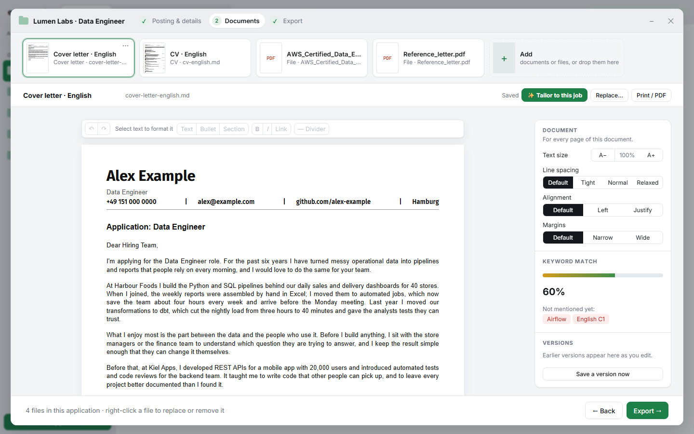
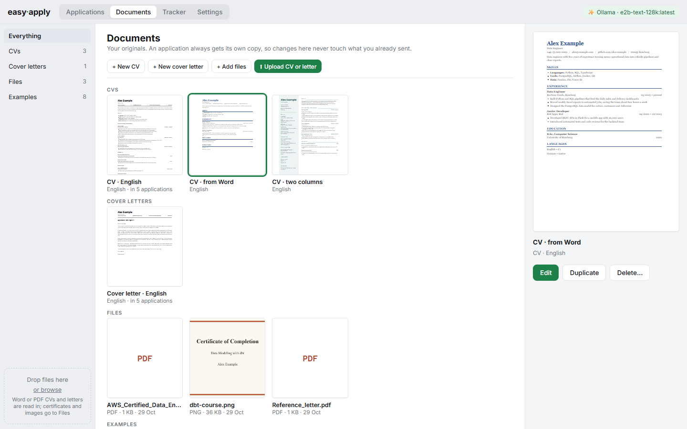
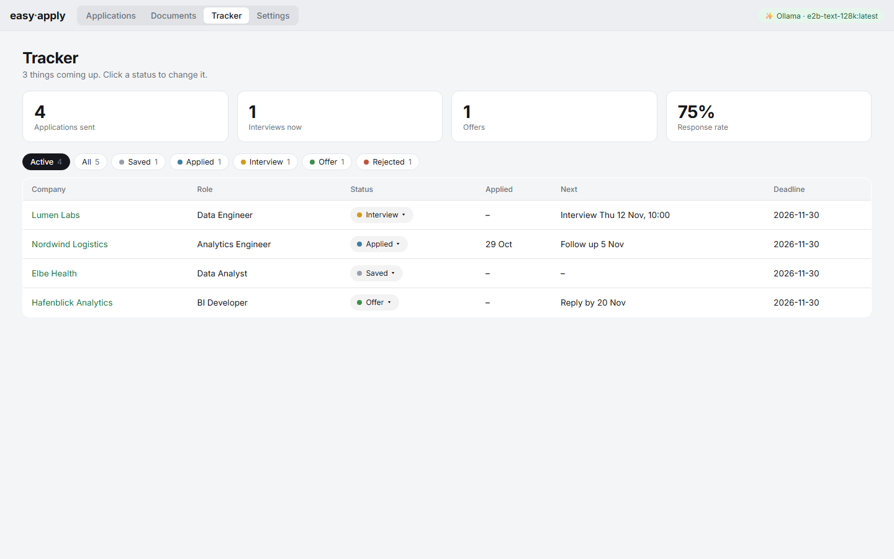
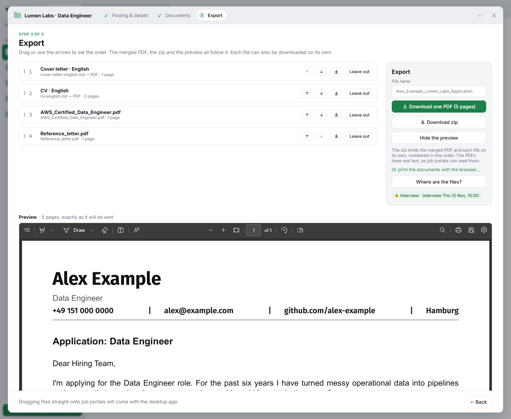
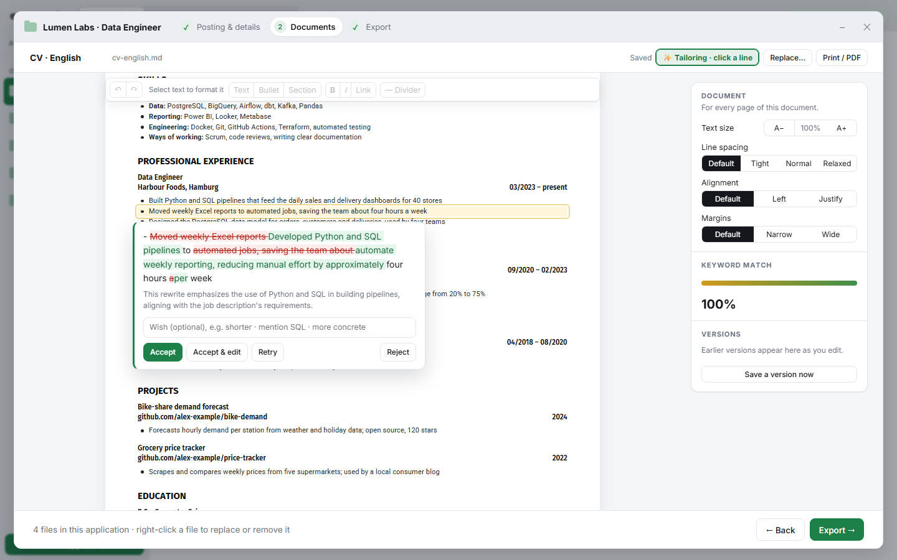

# Easy Apply

**Never lose track of which CV and cover letter you sent where.**

After a few weeks of job hunting, the files pile up: `CV_final.docx`, `CV_final_v2_EN.docx`, `Cover_Letter_Acme_new.pdf`… Which version went to which company? Did you change the German one too? What exactly did you send the company that just invited you to an interview?

Easy Apply keeps it all in order. Think in folders and files: every application gets its own folder, holding the posting, the exact CV and letter you sent, every earlier version, and where things stand.



## One place for every application

**A folder per job.** When you add a job, Easy Apply creates its folder. That folder holds:
- the posting, saved in case the ad disappears;
- the job's details: company, role, deadline and contact;
- that job's own copies of your CV and cover letter, plus any certificates or references you add.

**One application, one window.** Each application opens in its own window, in three steps: the posting, the documents, the export. Minimise it like an email you are writing, look something up, and come back. It saves as you go and opens where you left off.

**Your originals stay clean.** Your CVs, cover letters and files live under *Documents*. An application always works on its own copy, so changing a letter for one company never touches the original or any other application.



**Your file keeps its look.** Upload your CV and cover letter as Word or PDF. Easy Apply keeps their own fonts, sizes, colours and spacing; it doesn't force a design on you. No CV yet? Start from one of four complete examples, each a CV with a matching letter.

**Edit like in a word processor.** Click anywhere on the page and type. Select across lines, undo and redo, copy and paste between documents. The editor shows real pages, and the PDF breaks them in exactly the same places: what you see is what you send.

**Every version kept.** Each change you make is saved, and earlier versions stay in the job's folder. You can always see what you sent, and go back to any version with one click.

**Know where everything stands.** A tracker shows every application at a glance, with its status (applied, interview, offer, rejected), what's next, and when. Open any application to see exactly what you sent.



**Export it the same way every time.** Drag the documents for a job into order (letter, CV, certificates, references), preview them, and download one PDF, a zip, or each file on its own. You get the same clean result for every application, named the way you chose.



## Privacy first

Your CV is about as personal as documents get. Easy Apply treats it that way.

- **Your files stay with you.** Everything is stored as ordinary files in a folder you choose, or inside your browser, on your own computer. There's no account, no cloud and no server holding your data.
- **Nothing calls home.** No analytics, no tracking, no telemetry. Easy Apply only goes online when you ask it to: to fetch a job posting from a link, or to use the AI provider you chose.
- **You decide about AI.** It's entirely optional; the app works fully without it. If you want it, run a free model on your own computer (Ollama, LM Studio), so nothing leaves your machine. Or use your own key for OpenRouter, OpenAI or Gemini, and the app tells you when text goes to a cloud service.
- **Your keys stay in your browser.** They're never written into your documents folder, and they're only sent to the provider they belong to.
- **Works offline.** Once opened, Easy Apply runs without an internet connection, and a full backup is one click.

## Help along the way

- **Fill in a job from its posting.** Paste the ad or its link, and AI (if you use it) fills in the details.
- **Tailor with care.** Click a line to get a version matched to the job, and accept or reject it word by word. AI may only use facts from your own documents, and anything new is flagged.
- **Recently used first.** Adding documents to an application shows what you used last on top, with a large preview, like a Finder window.



## Good to know

- Word files keep their look best. A PDF keeps its fonts and sizes, but not its colours.
- Photos and other images inside a CV are left out; the text comes through.
- Designer templates built from floating text boxes come in as text, but may need their order and headings fixed by hand.

## Get started

You need [Node.js](https://nodejs.org) (version 20 or newer) and Chrome or Edge.

```bash
npm install
npm run dev
```

Open http://localhost:5173, choose where to keep your files, and upload your CV and cover letter. Easy Apply guides you through the rest.

Want to know how it works inside? See the [technical notes](docs/TECHNICAL.md).

## License

Copyright (c) 2026 Sadat Daniel. Easy Apply is free software under the [GNU Affero General Public License v3.0](LICENSE): you may use, change and share it, and if you share a changed version, or offer it to others as a website or service, you must publish your changes under the same licence.
