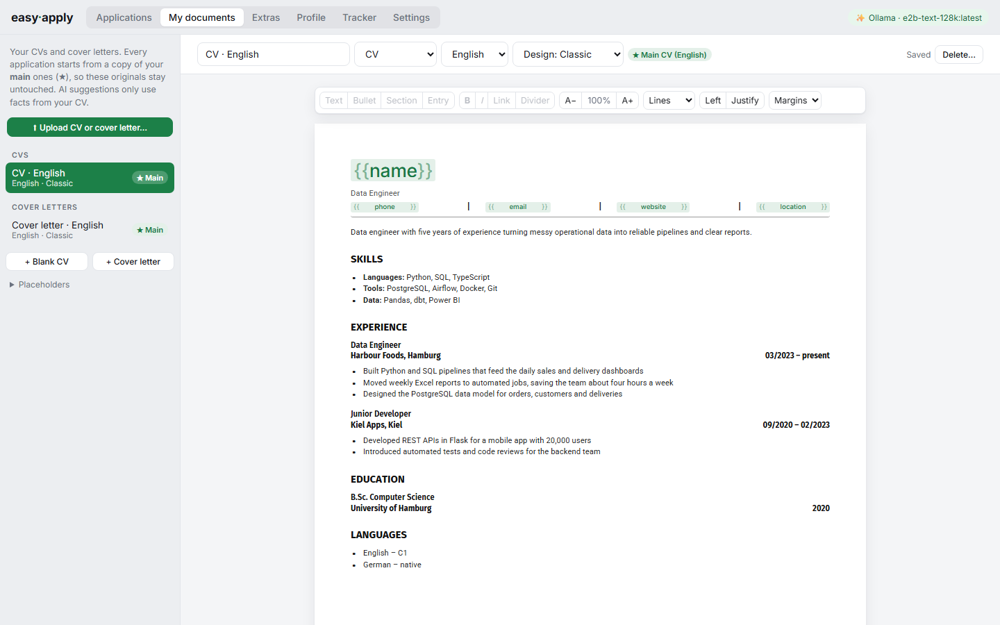
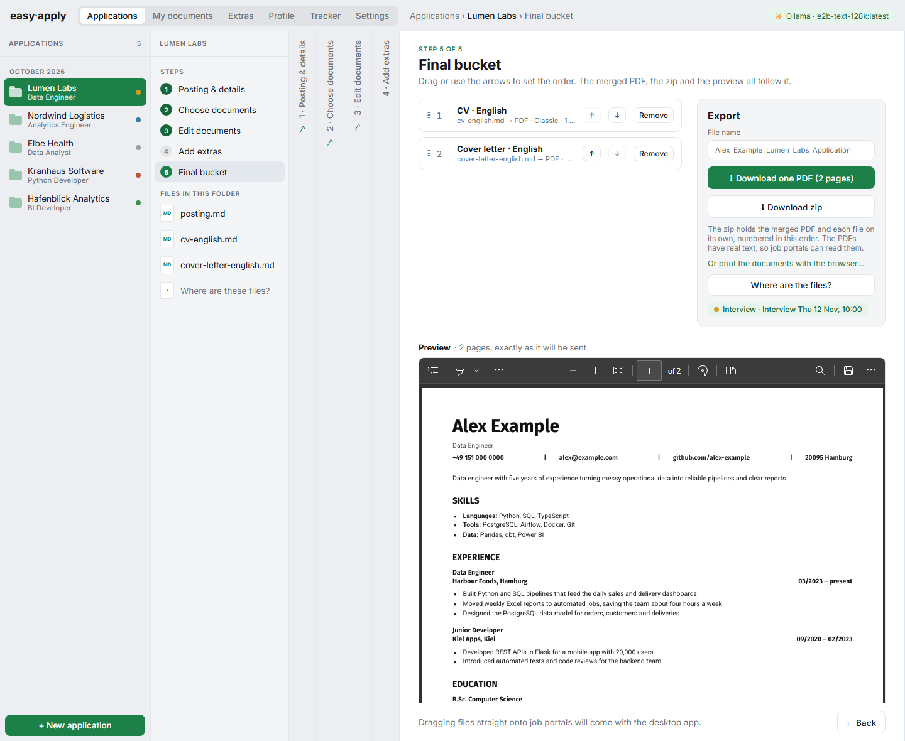

# Easy Apply

**Never lose track of which CV and cover letter you sent where.**

After a few weeks of job hunting, the files pile up: `CV_final.docx`, `CV_final_v2_EN.docx`, `Cover_Letter_Acme_new.pdf`… Which version went to which company? Did you change the German one too? What exactly did you send the company that just invited you to an interview?

Easy Apply keeps it all in order. Every application gets its own folder, holding the posting, the exact CV and letter you sent, every earlier version, and where things stand.


## One place for every application

**A folder per job.** When you add a job, Easy Apply creates its folder. That folder holds:
- the posting, saved in case the ad disappears;
- the job's details: company, role, deadline and contact;
- that job's own copy of your CV and cover letter.

**Your originals stay clean.** Your CVs and cover letters live under *Documents*. Each application starts from a copy of your main ones, so changing a letter for one company never touches the original or any other application.



**Every version kept.** Each change you make is saved, and earlier versions stay in the job's folder. You can always see what you sent, and go back to any version with one click.

**Know where everything stands.** A tracker shows every application at a glance, with its status (applied, interview, offer, rejected), what's next, and when. Open any application to see exactly what you sent.


**Send it the same way every time.** Put the documents for a job in order (CV, letter, certificates, references), preview them, and download one PDF or a zip. You get the same clean result for every application, named the way you chose.



## Privacy first

Your CV is about as personal as documents get. Easy Apply treats it that way.

- **Your files stay with you.** Everything is stored as ordinary files in a folder you choose, or inside your browser, on your own computer. There's no account, no cloud and no server holding your data.
- **Nothing calls home.** No analytics, no tracking, no telemetry. Easy Apply only goes online when you ask it to: to fetch a job posting from a link, or to use the AI provider you chose.
- **You decide about AI.** It's entirely optional; the app works fully without it. If you want it, run a free model on your own computer (Ollama, LM Studio), so nothing leaves your machine. Or use your own key for OpenRouter, OpenAI or Gemini, and the app tells you when text goes to a cloud service.
- **Your keys stay in your browser.** They're never written into your documents folder, and they're only sent to the provider they belong to.
- **Works offline.** Once opened, Easy Apply runs without an internet connection, and a full backup is one click.

## Help along the way

- **Upload what you have.** Bring in your existing CV and cover letter as Word or PDF. Easy Apply reads them for you, and a letter written for one company becomes reusable for the next.
- **Fill in a job from its posting.** Paste the ad or its link, and AI (if you use it) fills in the details.
- **Tailor with care.** Click a line to get a version matched to the job, and accept or reject it word by word. AI may only use facts from your own documents, and anything new is flagged.
- **Start from an example.** No CV yet? Pick one of four complete examples (a CV and a matching letter) and replace the details with yours.
- **What you see is what you send.** The editor shows real pages, and the PDF breaks them in exactly the same places.


## Get started

You need [Node.js](https://nodejs.org) (version 20 or newer) and Chrome or Edge.

```bash
npm install
npm run dev
```

Open http://localhost:5173, choose where to keep your files, and upload your CV and cover letter. Easy Apply guides you through the rest.

Want to know how it works inside? See the [technical notes](docs/TECHNICAL.md).

## License

Copyright (c) 2026 Sadat Daniel. Easy Apply is free software under the [GNU Affero General Public License v3.0](LICENSE): you may use, change and share it, and if you share a changed version, or offer it to others as a website or service, you must publish your changes under the same licence.
